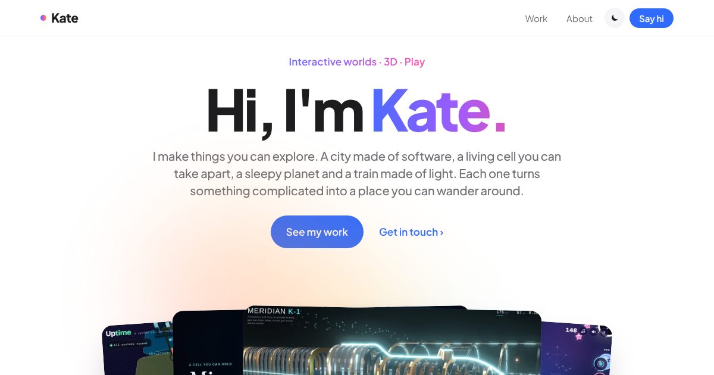

# Kate

My little universe of interactive worlds.

**Visit:** https://kate1819.github.io/

## Work

- [Uptime](https://kate1819.github.io/uptime/): a system architecture you can walk through
- [Microcosm](https://kate1819.github.io/microcosm/): a living cell you can hold
- [Meridian K-1](https://kate1819.github.io/meridian-k1/): a train made of light and brass
- [Sleepy Planet](https://kate1819.github.io/sleepy-planet/): shh, Earth is dreaming

## Updating the site

Everything you write lives in **`edit-me.js`**: name, intro, about, skills, background, links, the projects (title, text, links, picture, colour) and the words in the ribbon. To add a project picture, upload it to the `images` folder first. Open it on GitHub, click the pencil, change the text between the quotes and commit. Anything left empty stays hidden.
